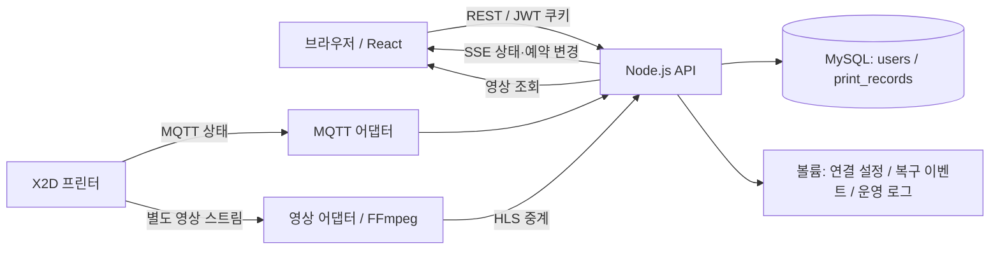

# Bambu Lab X2D 공용 프린터 웹 관리 시스템 설계서

> 상태: 구현 전 검토용 초안 · 작성일: 2026-10-17  
> 이 문서는 설계만 정의한다. 아래 디렉터리, API, 환경 변수는 구현 예정 사항이며 현재 실행 가능한 프로그램을 의미하지 않는다.

## [개요 및 설계 이유]

여러 사람이 공유하는 X2D 프린터 1대의 카메라, 현재 출력 상태, 출력 이력, 사용자별 필라멘트 사용량과 예약 현황을 하나의 웹 화면에서 관리한다.

| 요구 사항 | 설계 방향과 이유 |
| --- | --- |
| 실시간 현황 | 백엔드가 MQTT를 수집하고 SSE(Server-Sent Events)로 브라우저에 전달하여 프린터 연결을 한 곳에서 관리한다. |
| 카메라 | 백엔드가 별도 영상 프로토콜을 중계한다. MQTT는 상태 수집용이며 영상 전달 수단으로 가정하지 않는다. |
| 사용자별 관리 | 로그인 사용자와 실제 출력 작업을 연결하고, 소유자를 모르는 작업은 미지정으로 남긴다. |
| 예약 | 서버에서 시간 겹침을 검증하고 DB 트랜잭션으로 동시 예약을 직렬화한다. |
| DB 테이블 2개 | `users`, `print_records`만 사용한다. 예약을 출력 전 단계의 기록으로 저장한다. |
| 실행 환경 | React를 제공하는 Node 컨테이너, Node.js API 컨테이너, MySQL 컨테이너로 구성한다. |
| 관리자 연결 설정 | 우측 상단 설정 아이콘에서 프린터 이름, IP, 시리얼 번호, 인증 정보를 관리한다. |

초기 범위는 모니터링, 예약, 사용자 및 이력 관리이다. 출력 파일 전송, 원격 출력 시작·중지, 슬라이싱, 결제, 스풀 재고 관리는 포함하지 않는다. **예약은 이용 시간에 대한 약속이며 프린터 자체의 출력을 잠그거나 자동 실행하지 않는다.** 예약 시간이 지나도 실제 출력은 계속될 수 있으므로 예약 상태와 프린터 상태를 별도로 표시한다.

설계 기본 정책은 다음과 같다. 검토 과정에서 변경할 수 있다.

- 비로그인 방문자는 내부망 대시보드와 예약의 점유 시간만 조회한다. 카메라와 상세 이력은 로그인 후 제공한다.
- 일반 사용자는 자신의 이력·사용량을 조회하고, 관리자는 전체 사용자별 이력·사용량을 조회한다.
- 계정은 관리자가 발급한다. 공개 회원가입은 제공하지 않는다.
- 한 예약은 한 출력 작업에 대응한다. 여러 번 출력하려면 예약을 나누며, 추가로 감지된 작업은 별도 기록으로 남긴다.
- 예약 기본 단위는 30분, 최대 길이는 24시간, 예약 가능 범위는 30일이다. 시간은 DB에 UTC로 저장하고 화면에서는 `Asia/Seoul`로 표시한다.

## [논리 아키텍처]

### 구성과 데이터 흐름



1. API 시작 시 환경 변수와 저장된 프린터 설정을 읽고 MQTT에 연결한다.
2. MQTT 어댑터는 모델·펌웨어별 원본 필드를 공통 상태로 변환한다. 부분 업데이트는 기존 상태에 병합하며 누락 필드를 0으로 덮어쓰지 않는다.
3. 진행률, 출력 단계, 남은 시간, 노즐별 온도, 베드 온도, 오류와 마지막 수신 시각을 메모리에 유지한다. 지원하지 않는 필드는 `null`과 함께 미지원으로 표시한다.
4. 실제 작업의 시작·종료와 주요 변경만 MySQL에 기록한다. 모든 온도 메시지를 DB에 누적하지 않는다.
5. API는 커밋된 변경을 SSE로 전달한다. 브라우저 재접속 시 REST로 전체 상태와 예약 목록을 다시 동기화한다.
6. 영상 어댑터는 검증된 프린터 영상 소스를 HLS로 변환한다. React는 브라우저 지원에 따라 기본 플레이어나 HLS 플레이어를 사용한다. 영상은 수 초 지연될 수 있다.

### 데이터 모델: 애플리케이션 테이블은 정확히 2개

별도 예약·프린터·세션·필라멘트 테이블을 만들지 않는다. ORM을 도입하더라도 마이그레이션 이력용 테이블을 자동 생성하지 않는 방식으로 운용한다. 스키마 변경 SQL은 파일로 버전 관리한다.

#### 1. `users` — 사용자

| 필드 | 타입(안) | 용도 |
| --- | --- | --- |
| `id` | BIGINT PK | 사용자 식별자 |
| `login_id` | VARCHAR(100), UNIQUE | 정규화한 로그인 ID |
| `display_name` | VARCHAR(100) | 화면 표시 이름 |
| `password_hash` | VARCHAR(255) | Argon2id 비밀번호 해시 |
| `role` | ENUM(`ADMIN`, `USER`) | 권한 |
| `is_active` | BOOLEAN | 계정 활성 상태 |
| `must_change_password` | BOOLEAN | 초기·재설정 비밀번호 변경 요구 |
| `token_version` | INT | 비밀번호 변경·로그아웃 등에서 토큰 무효화 |
| `created_at`, `updated_at` | DATETIME(3) | 생성·변경 시각, UTC |

사용자는 물리 삭제하지 않고 비활성화하여 과거 출력 이력을 보존한다. 마지막 활성 관리자 계정의 비활성화·권한 강등을 막는다.

#### 2. `print_records` — 예약 및 실제 출력 기록

| 필드 | 타입(안) | 용도 |
| --- | --- | --- |
| `id` | BIGINT PK | 예약/출력 기록 ID |
| `user_id` | BIGINT NULL FK → users.id | 실제 출력 소유자 또는 예약자, 미지정 허용 |
| `printer_key` | VARCHAR(100) | 설정 변경에도 유지되는 프린터 식별자 |
| `title`, `file_name` | VARCHAR(255), 후자는 NULL 허용 | 예약명, 실제 파일명 |
| `reservation_start`, `reservation_end` | DATETIME(3) NULL | 예약 시간 구간 |
| `reservation_status` | ENUM(`NONE`, `BOOKED`, `CANCELLED`, `EXPIRED`) | 예약 유효 여부 |
| `print_status` | ENUM(`NOT_STARTED`, `PRINTING`, `PAUSED`, `COMPLETED`, `FAILED`, `CANCELLED`, `UNKNOWN`) | 실제 출력 상태 |
| `started_at`, `finished_at` | DATETIME(3) NULL | 실제 출력 시각 |
| `external_job_id` | VARCHAR(255) NULL | 프린터가 제공한 작업 ID 원본 |
| `job_key` | VARCHAR(255) NULL, UNIQUE | 재시작·재수신 시 중복 기록 방지용 정규화 작업 키 |
| `ownership_status` | ENUM(`UNASSIGNED`, `CONFIRMED`) | 소유자 확인 여부 |
| `armed_at`, `armed_until` | DATETIME(3) NULL | 사용자가 다음 작업 연결을 신청한 유효 시간 |
| `estimated_filament_g` | DECIMAL(12,3) NULL | 슬라이서 등에서 얻은 예상량 |
| `actual_filament_g` | DECIMAL(12,3) NULL | 실측 또는 신뢰 가능한 실제 소비량 |
| `filament_source` | VARCHAR(30) NULL | `SLICER`, `DEVICE`, `MANUAL_MEASURED` 등 출처 |
| `filament_details` | JSON NULL | 재료·색상·슬롯·노즐별 예상량/실제량, 퍼지 포함 여부 |
| `metadata` | JSON NULL | 식별 근거, 수신 공백, 보정 사유·수정자·시각 등 |
| `version` | INT | 변경 충돌 방지용 낙관적 잠금 버전 |
| `created_at`, `updated_at` | DATETIME(3) | 생성·변경 시각 |

인덱스는 `(user_id, started_at)`, `(printer_key, reservation_status, reservation_start, reservation_end)`, `(printer_key, print_status)`를 둔다. 예약 양 끝 시각은 둘 다 존재하거나 둘 다 NULL이어야 하며, 시작은 종료보다 빨라야 한다. 무예약 출력은 `reservation_status=NONE`이다. 예약 취소와 실제 출력 취소를 구분한다.

JSON은 여러 재료의 상세 내역과 보정 근거 보관에 한정한다. 조회·집계에 필요한 사용자, 시간, 상태와 총량은 정규 컬럼으로 유지한다. 두 테이블 제약 때문에 재료별 분석, 독립적인 예약-복수출력 관계, 변경 불가능한 감사 이력에는 한계가 있다.

### 예약 처리와 동시성

- 시간 구간은 `[시작, 종료)`로 취급한다. 10:00–11:00과 11:00–12:00은 겹치지 않는다.
- 겹침 조건은 `existing.start < requested.end AND existing.end > requested.start`이다. `BOOKED` 예약만 검사한다.
- 예약 생성·시간 변경·취소·작업 연결·수집기의 예약 상태 변경은 공통 서비스 경로를 사용한다. 전용 MySQL 연결에서 프린터별 `GET_LOCK`을 획득하고 트랜잭션을 시작하여 최신 예약을 검사한 후 커밋한다. `finally`에서 `RELEASE_LOCK` 후 연결을 반환한다.
- 빈 예약 테이블에서도 같은 프린터에 대한 요청이 직렬화되어야 한다. 단순 사전 SELECT나 프론트엔드 버튼 비활성화만으로 충돌을 방지하지 않는다. 잠금 시간 초과는 재시도 가능한 오류로 반환한다.
- 미래 예약의 신규·수정만 허용하며 이미 출력과 연결된 예약의 시간 수정·일반 사용자 취소는 막는다. 관리자 보정도 다른 유효 예약과 겹칠 수 없다.
- 종료 시각까지 작업이 연결되지 않은 예약은 `EXPIRED`로 표시하고 연결 대기를 해제한다. 판정은 요청 시에도 수행하여 스케줄러 재시작으로 판정이 늦어지지 않게 한다.
- 예약 시간 초과 출력은 `출력 중 / 예약 시간 초과`로 표시한다. 다음 예약은 유지하며 사용자에게 지연 가능성을 알린다.
- 프린터 오프라인 상태에서도 미래 예약은 가능하지만 즉시 사용 가능 여부는 `확인 불가`로 표시한다.

### 실제 출력과 사용자 연결

MQTT의 작업 정보가 웹 로그인 사용자를 식별한다고 가정하지 않는다. 예약 시간에 출력이 시작됐다는 이유만으로 소유자를 자동 확정하지 않는다.

1. 사용자는 자신의 예약 시작 이후 종료 이전에 **이 예약에 다음 출력 연결**을 누른다. 연결 대기 유효 시간은 기본 10분이며 예약 종료 시각을 넘지 않는다.
2. 서버는 현재 진행 작업 및 다른 유효 연결 대기가 없는지 확인하고 예약 행에 연결 대기를 저장한다. 이 버튼은 프린터로 출력 명령을 보내지 않는다.
3. 정상 수집 중 새 작업 시작이 감지되면 해당 예약 행에 실제 작업 ID와 시각을 연결한다. 이는 사용자의 명시적 선언에 따른 귀속이며 물리적 사용자를 인증하는 기능은 아니다.
4. 유효한 연결 대기가 없거나 수신 공백으로 시작 시점을 확신할 수 없으면 `user_id=NULL`인 별도 출력 기록을 만든다. 로그인 중인 사람이나 가장 가까운 예약자를 임의로 배정하지 않는다.
5. 관리자가 미지정·잘못 연결된 작업의 소유자를 지정하거나 수정한다. 수정 사유·수정자·시각과 이전 값을 `metadata`에 남긴다.

작업 키는 실기 검증된 작업 식별 필드와 프린터 식별자를 조합한다. 파일명만으로 식별하지 않는다. 안정적인 작업 ID가 없으면 시작 전이에서 서버 실행 ID를 발급해 저장하고 재접속 시 기존 진행 기록과 비교한다. 식별이 모호하면 자동 병합·새 출력 확정 대신 확인 필요 상태로 보존한다.

### 필라멘트 집계와 수집 장애

- 기본 단위는 g이며 화면에서 필요 시 kg로 변환한다. 미수집 값은 NULL이고 0g와 구분한다.
- 슬라이서 예상량을 실제 소비량으로 표시하지 않는다. 실제값을 얻지 못하면 예상량만 표시하고 관리자 실측 입력을 지원한다.
- 실패·취소 출력도 재료를 사용하므로 집계 대상이다. 실패 시 예상량에 진행률을 곱해 실제 사용량을 만들어내지 않는다.
- 사용자별 통계는 `started_at`이 조회 기간에 속하는 실제 출력에 대해 출력 횟수, 상태별 건수, 예상량 합계, 실제량 합계, 실제량 미확인 건수를 각각 제공한다. 예약 전용 행과 미지정 사용자는 개인 통계에서 제외한다.
- 다중 재료 상세 합계와 총량은 같은 트랜잭션에서 검증한다. 퍼지·서포트 포함 여부가 불명확하면 화면에 표시한다.
- MQTT 연결은 지수 백오프로 재시도한다. 마지막 수신 후 기본 60초가 지나면 오래된 정보로 표시하며 연결 단절을 출력 실패로 처리하지 않는다.
- 재시작 시 DB의 진행 기록과 새 스냅샷을 대조한다. 수신하지 못한 종료 시각·결과는 추정 확정하지 않고 `UNKNOWN`과 확인 필요 표시를 남긴다. 지연 메시지로 완료 상태를 출력 중으로 되돌리지 않는다.
- DB 장애 중 주요 이벤트는 제한된 크기의 영속 복구 파일에 기록하고 작업 키로 중복 없이 재처리한다. 용량 초과나 서버 전체 중단 중 발생한 작업은 복구를 보장할 수 없으므로 누락 구간을 표시한다. 과거 프린터 이력 전체를 MQTT로 소급 수집할 수 있다고 가정하지 않는다.

## [인프라 아키텍처]

### Docker Compose 구성

| 서비스 | 역할 | 네트워크·저장소 |
| --- | --- | --- |
| `frontend` | Node 기반 서버가 React 빌드 정적 파일을 제공하고 API/SSE/영상 경로를 프록시 | 호스트 웹 포트만 공개, `/api`는 `backend:3000`으로 전달 |
| `backend` | Node.js + TypeScript + Express 기반 API, MQTT 수집, SSE, 영상 중계 | 내부 3000 포트, 프린터 LAN으로 접근, `app_data` 볼륨 |
| `mysql` | MySQL 8.4 계열 InnoDB, utf8mb4 | 내부 3306 포트, `mysql_data` 볼륨 |

React 빌드 도구는 Vite를 사용하되 운영 시 개발 서버를 노출하지 않는다. Node 이미지 버전과 라이브러리 버전은 구현 시 지원 중인 LTS·호환성을 확인하고 고정한다. FFmpeg는 백엔드 이미지에 포함해 자식 프로세스로 관리하는 안을 기본으로 하며, 실기 영상 프로토콜에 따라 중계 구현을 확정한다. 별도 MQTT 브로커는 초기 구성에 포함하지 않고 프린터의 접속점을 사용한다.

```text
브라우저 ─ HTTPS ─ 배포 환경의 TLS 종단 ─ frontend:8080
                                            └─ backend:3000 ─ mysql:3306
                                                   └─ 프린터 LAN (MQTT / 영상)
```

- 운영 HTTPS는 기존 게이트웨이·리버스 프록시 또는 frontend Node TLS 설정으로 제공한다. 개발 HTTP는 로컬 전용이다.
- 동일 출처에서 API·SSE·영상을 제공한다. SSE 프록시 버퍼링을 끄고 heartbeat 및 연결 타임아웃을 조정한다.
- 백엔드와 MySQL은 호스트에 직접 포트를 공개하지 않는다. 프린터 MQTT·영상 서비스도 인터넷에 노출하지 않는다.
- Docker 호스트에서 프린터 IP로 접근할 수 있어야 한다. 기본 bridge 네트워크를 사용하고 Windows Docker Desktop에서도 LAN 라우팅·방화벽을 검증한다.
- 백엔드는 초기 1개 인스턴스로 운영한다. 다중 인스턴스 확장에는 MQTT 수집 리더와 영상 처리 중복 방지 설계가 추가로 필요하다.
- `mysql_data`에는 DB, `app_data`에는 암호화된 연결 설정·복구 이벤트를 저장한다. HLS 조각은 용량 제한 임시 디렉터리에 저장하고 자동 삭제하며 영상을 장기 보관하지 않는다.
- MySQL 준비 완료 후 백엔드가 시작되도록 healthcheck를 두고, 백엔드는 별도 재시도도 수행한다. DB 장애 시 쓰기를 실패 처리하고 프린터 오프라인은 API 자체 장애와 구별한다.
- DB와 설정 볼륨을 매일 백업하고 복원 절차를 검증한다. 설정 암호화 키는 백업 데이터와 분리해 보관한다. 로그는 비밀번호·JWT·프린터 인증 정보를 제거하고 회전·보존 기간을 설정한다.

## [사전 요구 사항]

### 장비·운영 환경

- X2D 1대, 고정 IP 또는 DHCP 예약, 프린터와 통신 가능한 상시 실행 Docker 호스트.
- Docker Engine/Desktop 및 Compose 플러그인, 지속 저장 공간과 시간 동기화. 영상 변환 부하는 해상도·코덱·시청 인원에 따라 측정한다.
- 프린터 이름, IP, 시리얼 번호, LAN 인증 정보, 펌웨어 버전. IP와 이름만으로 인증이 완료된다고 가정하지 않는다.
- 운영용 도메인 또는 내부 접속 주소, HTTPS 인증서, 초기 관리자 계정과 백업 위치.

### X2D 연동 검증 항목

공식 X2D 매뉴얼에는 LAN Only와 Developer Mode가 안내되어 있다. 실제 설치된 펌웨어에서 필요한 모드와 접근 권한을 확인한다. 참고한 매뉴얼은 v1.0(2026.05), 적용 펌웨어 01.01.00.00이며 설치 기기와 다를 수 있다. [Bambu Lab X2D 공식 사용자 매뉴얼, 100–101쪽](https://csm.bblcdn.com/hub/7c58718aaa2e40edab56efb87419a96a.pdf)

다음은 확정된 제품 사양이 아니라 **구현 시작 시 실기에서 검증할 계약**이다.

| 항목 | 검증 내용 / 실패 시 처리 |
| --- | --- |
| MQTT | 접속 주소·포트·TLS 인증서·사용자명·비밀번호·구독 토픽과 읽기 권한을 확인한다. 미확인 관행값을 X2D 고정값으로 사용하지 않는다. |
| 상태 필드 | 출력 시작/일시정지/완료/실패, 작업 ID, 파일명, 진행률, 온도, 잔여 시간의 샘플을 확보한다. 누락 필드는 미지원으로 표시한다. |
| 카메라 | LAN 영상 활성화 조건, 접근 프로토콜·경로·코덱·인증 방식 및 FFmpeg 수신 가능 여부를 확인한다. RTSP/RTSPS라고 단정하지 않는다. 실패 시 영상 미지원/연결 실패를 표시한다. |
| 사용량 | 예상량·실제량·재료별 내역을 어디서 얻는지 확인한다. MQTT에 없으면 초기 버전은 관리자 입력을 사용한다. |
| 재연결 | 작업 중 API 재시작, 프린터 재부팅, 동일 파일 재출력, 중복·지연 메시지를 검증한다. |
| 접근 통제 | 외부 명령 서명·펌웨어 정책 때문에 필요한 권한이 달라질 수 있으므로 상태 조회와 영상 접근을 각각 확인한다. |

본 설계에서 제조사 클라우드 계정 연동과 추가 파일 전송 프로토콜은 필수 의존성으로 두지 않는다. 카메라·사용량 자동 수집이 검증되지 않아도 예약·사용자 관리 설계와 분리하여 검토한다.

## [핵심 환경 변수 (.env)]

실제 `.env`는 Git에 커밋하지 않는다. 아래는 이름과 용도이며 실제 파일은 구현 단계에서 만든다. 비밀값을 React 번들에 포함되는 환경 변수로 전달하지 않는다.

| 변수 | 예시 또는 기본값 | 설명 |
| --- | --- | --- |
| `NODE_ENV` | `production` | 실행 모드 |
| `WEB_PORT` | `8080` | frontend 호스트 포트 |
| `PUBLIC_ORIGIN` | `https://printer.example.internal` | 허용 웹 출처·CSRF 검증 기준 |
| `BACKEND_PORT` | `3000` | 내부 API 포트 |
| `DB_HOST`, `DB_PORT` | `mysql`, `3306` | DB 접속점 |
| `DB_NAME`, `DB_USER` | `bambu_monitor`, `bambu_app` | 애플리케이션 전용 DB와 최소 권한 계정 |
| `DB_PASSWORD` | 필수 비밀값 | 애플리케이션 DB 비밀번호 |
| `MYSQL_ROOT_PASSWORD` | 필수 별도 비밀값 | MySQL 초기화용, API는 root를 사용하지 않음 |
| `JWT_SECRET` | 최소 32바이트 난수 | JWT 서명 키 |
| `JWT_ISSUER`, `JWT_AUDIENCE` | `bambu-monitor`, `bambu-web` | 토큰 검증 대상 |
| `JWT_TTL_SECONDS` | `3600` | 로그인 유효 시간, 만료 시 재로그인 |
| `COOKIE_SECURE` | `true` | 운영에서 HTTPS 쿠키 강제 |
| `DISPLAY_TIMEZONE` | `Asia/Seoul` | UI 기본 시간대, DB 세션은 UTC |
| `BOOTSTRAP_ADMIN_LOGIN` | 최초 설치 시 지정 | 관리자 초기 생성 ID |
| `BOOTSTRAP_ADMIN_PASSWORD` | 최초 설치 시 비밀값 | 초기화 후 제거, 기존 관리자 비밀번호를 덮어쓰지 않음 |
| `SETTINGS_ENCRYPTION_KEY` | 32바이트 난수의 Base64 | 저장된 프린터 비밀값 암호화 |
| `SETTINGS_PATH` | `/app/data/printer-settings.json` | 영속 설정 파일 경로 |
| `PRINTER_NAME`, `PRINTER_HOST` | 최초 설정용, 미설정 허용 | 표시 이름·접속 주소 |
| `PRINTER_SERIAL`, `PRINTER_ACCESS_CODE` | 실기 확인 후 지정 | 초기 식별·인증 정보 |
| `MQTT_PORT`, `MQTT_USERNAME`, `MQTT_REPORT_TOPIC` | 실기 확인 후 지정 | 포트·인증 사용자·상태 구독 토픽 |
| `MQTT_CA_PATH` | 선택 | 사설 CA 경로, TLS 검증을 기본 유지 |
| `CAMERA_SOURCE_URL` | 실기 확인 후 지정 | 서버 전용 영상 원본 주소, 응답·로그에 노출 금지 |
| `STATUS_STALE_SECONDS` | `60` | 상태 수신 지연 표시 기준 |
| `RESERVATION_SLOT_MINUTES` | `30` | 예약 시간 단위 |
| `RESERVATION_MAX_HOURS` | `24` | 1회 예약 최대 길이 |
| `RESERVATION_HORIZON_DAYS` | `30` | 예약 가능 기간 |
| `JOB_LINK_WINDOW_MINUTES` | `10` | 다음 출력 연결 대기 시간 |
| `LOG_LEVEL` | `info` | 운영 로그 수준 |

Compose에서 DB 변수는 MySQL 초기화 변수와 명시적으로 매핑한다. 초기화 변수 변경만으로 기존 DB 비밀번호가 변경되지는 않는다.

프린터 설정의 우선순위는 **GUI에서 저장한 설정 > 초기 환경 변수**이다. GUI는 `.env`를 수정하지 않는다. 별도 DB 테이블 없이 볼륨의 설정 파일에 인증 정보를 인증된 암호화 방식(AES-256-GCM 등)으로 저장하고 파일 접근 권한을 제한한다. 저장은 원자적 교체로 수행하고 연결 재설정 실패 시 이전 설정으로 복원한다. 암호화 키는 설정 파일과 같은 위치에 저장하지 않는다.

## [프로젝트 구조]

아래는 이 README가 있는 `Bamboolab_monitor_page/`를 기준으로 한 구현 예정 구조다. 이번 단계에서는 README만 작성한다.

```text
Bamboolab_monitor_page/
├── README.md
├── LICENSE
├── compose.yaml
├── .env.example
├── .gitignore
├── frontend/
│   ├── Dockerfile
│   ├── package.json
│   ├── server/                 # 정적 파일 제공 및 API/SSE/영상 프록시
│   └── src/
│       ├── pages/              # Dashboard, Login, MyHistory, AdminUsers
│       ├── components/         # Camera, PrintStatus, History, Reservation, Settings
│       ├── api/                # REST 클라이언트 및 SSE 재연결
│       └── types/
├── backend/
│   ├── Dockerfile
│   ├── package.json
│   └── src/
│       ├── config/             # 환경 변수 및 암호화 설정 파일
│       ├── middleware/         # JWT, RBAC, CSRF, 오류 처리
│       ├── routes/
│       ├── services/           # 예약, 사용자, 출력 연결, 통계
│       ├── repositories/       # 두 테이블 접근 및 트랜잭션
│       ├── printer/            # MQTT·카메라 어댑터, 작업 식별
│       └── jobs/               # 예약 만료 및 장애 복구
├── database/
│   ├── schema.sql             # users, print_records만 생성
│   └── migrations/            # 검토 후 순서대로 적용할 변경 SQL
└── tests/
    ├── integration/           # 예약 경합, 권한, 복구 검증
    └── fixtures/              # 비밀값을 제거한 MQTT 샘플
```

## [사용자 관리]

### 역할별 권한

| 기능 | 비로그인 | USER | ADMIN |
| --- | --- | --- | --- |
| 현재 출력 상태·예약 점유 시간 | 조회 | 조회 | 조회 |
| 카메라 | 불가 | 조회 | 조회 |
| 메인 출력 이력 | 익명 요약 | 타인은 익명 요약, 본인은 상세 | 전체 상세 |
| 예약 생성 | 불가 | 본인 | 본인 또는 사용자 지정 |
| 예약 수정·취소 | 불가 | 본인의 미시작 예약 | 전체 미시작 예약 |
| 다음 출력 연결 | 불가 | 본인의 유효 예약 | 유효 예약, 대상 사용자 명시 |
| 사용자별 이력·사용량 | 불가 | 본인 | 전체 및 사용자별 |
| 출력 소유자·사용량 보정 | 불가 | 불가 | 가능, 사유 필수 |
| 계정 발급·비활성화·비밀번호 재설정 | 불가 | 불가 | 가능 |
| 본인 비밀번호 변경·로그아웃 | 불가 | 가능 | 가능 |
| 프린터 설정 조회·변경 | 불가 | 불가 | 가능 |

익명 요약에서는 표시 이름, 파일명, 이메일·로그인 ID를 제외한다. 전체 이력 API나 SSE에서도 동일한 필터를 적용한다. 일반 사용자에게 전체 사용자 목록을 제공하지 않는다.

### JWT와 계정 수명주기

- 최초 설치 시 명시적인 초기화 절차로 관리자 1명을 만든다. 기본 공용 비밀번호를 제공하지 않는다.
- 비밀번호는 Argon2id로 해시하고, 로그인 실패 제한과 일반화된 오류 응답으로 계정 추측을 줄인다.
- JWT에는 `sub`, `token_version`, `iss`, `aud`, `iat`, `exp`를 포함한다. 서명 알고리즘을 서버에서 고정한다.
- JWT는 `HttpOnly`, `Secure`, `SameSite=Lax`, `Path=/` 쿠키로 전달한다. 브라우저 localStorage와 URL에 저장하지 않는다.
- 변경 요청에는 CSRF 토큰과 Origin 검증을 적용한다. 로그인을 포함한 인증 관련 경로에도 출처 검증을 적용한다.
- 서버는 요청마다 사용자의 활성 상태와 현재 역할·토큰 버전을 확인한다. 프론트엔드의 아이콘 숨김만으로 권한을 판단하지 않는다.
- 초기 비밀번호 변경 전에는 비밀번호 변경과 로그아웃만 허용한다. 비밀번호 변경·계정 비활성화·권한 변경 시 버전을 증가시켜 기존 토큰을 폐기한다.
- 로그아웃도 버전을 증가시키는 방식으로 설계하며 해당 사용자의 모든 기기에서 로그아웃된다. 별도 세션 테이블이나 refresh token은 초기 버전에서 사용하지 않는다.
- SSE는 토큰 만료 시 종료하고 계정 상태도 주기적으로 다시 확인한다. HLS 재생 목록과 조각 파일 요청 모두 권한을 검사한다.

## [주요 API]

기본 경로는 `/api/v1`이다. ID는 JSON에서 문자열로 전달하여 BIGINT 정밀도 손실을 피한다. 시간은 오프셋이 있는 ISO 8601로 받고 UTC로 정규화한다. 목록에는 페이지네이션과 기간 상한을 적용한다.

| 메서드·경로 | 권한 | 기능 |
| --- | --- | --- |
| `POST /auth/login` | 공개 | ID·비밀번호 확인, JWT 쿠키 발급 |
| `POST /auth/logout` | 로그인 | 토큰 버전 증가 및 쿠키 삭제 |
| `GET /auth/me` | 로그인 | 현재 사용자·권한·비밀번호 변경 필요 여부 |
| `GET /auth/csrf` | 로그인 | 변경 요청용 CSRF 토큰 발급 |
| `PATCH /auth/password` | 로그인 | 현재 비밀번호 확인 후 본인 비밀번호 변경 |
| `GET /printer/status` | 공개 | 프린터·예약 상태와 마지막 수신 시각, 공개 필드만 반환 |
| `GET /events` | 공개/로그인 | 권한에 맞춘 SSE: 상태·예약·이력 변경, 비밀 정보 제외 |
| `GET /camera/stream.m3u8` | 로그인 | 인증된 HLS 재생 목록 |
| `GET /camera/segments/:name` | 로그인 | 허용된 조각 파일만 제공, 경로 탐색 차단 |
| `GET /reservations?from=&to=` | 공개/로그인 | 공개는 점유 시간만, 본인/관리자에게 허용 상세 제공 |
| `POST /reservations` | 로그인 | 시작·종료·제목으로 예약, USER의 소유자는 JWT에서 결정 |
| `PATCH /reservations/:id` | 본인/관리자 | 버전 검사 및 겹침 재검증 후 수정 |
| `POST /reservations/:id/cancel` | 본인/관리자 | 예약만 취소, 실제 출력 중지는 수행하지 않음 |
| `POST /reservations/:id/arm` | 본인/관리자 | 다음 출력 연결 대기 등록 |
| `DELETE /reservations/:id/arm` | 본인/관리자 | 연결 대기 해제 |
| `GET /prints` | 공개/로그인 | 메인 이력 목록, 역할별 필드 필터링 |
| `GET /prints/:id` | 본인/관리자 | 실제 출력 상세 및 재료 내역 |
| `GET /users/me/prints` | 로그인 | 본인 출력 기록, 기간·상태 필터 |
| `GET /users/me/usage` | 로그인 | 본인 사용량·미확인 건수 집계 |
| `GET /admin/users` | 관리자 | 사용자 목록 |
| `POST /admin/users` | 관리자 | 사용자 발급 |
| `PATCH /admin/users/:id` | 관리자 | 표시 이름·권한·활성 상태 변경 |
| `POST /admin/users/:id/reset-password` | 관리자 | 임시 비밀번호 설정, 기존 JWT 폐기 |
| `GET /admin/users/:id/prints` | 관리자 | 특정 사용자 이력 |
| `GET /admin/usage?from=&to=&userId=` | 관리자 | 사용자별 집계, 미지정 작업 별도 집계 |
| `PATCH /admin/prints/:id` | 관리자 | 소유자·사용량·불명확 결과 보정, 사유·버전 필수 |
| `GET /admin/printer-settings` | 관리자 | 이름·IP·시리얼·연결 상태, 비밀값은 설정 여부만 반환 |
| `POST /admin/printer-settings/test` | 관리자 | 입력 설정의 MQTT·영상 접속을 각각 검사 |
| `PUT /admin/printer-settings` | 관리자 | 설정 검증·암호화 저장·재연결 |
| `GET /health/live`, `GET /health/ready` | 내부 점검 | 프로세스 생존 및 DB 등 필수 서비스 준비 여부 |

예약 생성 예시:

```json
{
  "title": "시제품 케이스",
  "startAt": "2026-10-20T10:00:00+09:00",
  "endAt": "2026-10-20T12:00:00+09:00"
}
```

예약 충돌은 HTTP 409와 `{ "error": { "code": "RESERVATION_CONFLICT", "message": "선택한 시간에 예약이 있습니다." } }`를 반환한다. 충돌 사용자의 개인정보는 포함하지 않는다. 입력 오류는 400, 미인증은 401, 권한 부족은 403, 변경 버전 충돌은 409, 로그인 제한은 429, DB·설정 잠금 등 일시 장애는 503으로 구분한다. 다른 사용자의 비공개 기록은 존재 여부를 드러내지 않도록 404로 처리한다.

프린터 설정의 접속 대상은 허용한 프린터 LAN 대역·프로토콜·포트로 제한하고 연결 시간 제한을 둔다. 임의 URL 접근이나 셸 문자열 실행을 허용하지 않는다. 영상 URL의 인증 정보, MQTT 비밀번호, 암호화 키는 API 응답에서 반환하지 않는다. 활성 출력 중 연결 설정 변경은 차단한다.

## [웹 UI 가이드]

### 메인 페이지 배치

첨부된 `p1.png`의 세 열 구조를 기준으로 한다. 좌측은 상단 카메라·하단 현재 출력 정보, 가운데는 지금까지의 출력 기록, 우측은 예약과 개인 관리 이동 영역이다.

```text
┌────────────────────────────────────────────────────────────────────────┐
│ X2D 공용 프린터    [연결 상태]             [로그인/사용자] [⚙ 관리자]    │
├──────────────────────────┬──────────────────────┬──────────────────────┤
│ 프린터 영상              │ 지금까지 출력 기록   │ [내 이력·사용량 ↗]   │
│                          │                      │ 예약 상태 배지       │
│ 16:9 영상 / 전체 화면    │ 날짜·작업·상태       │ 오늘 / 날짜 선택     │
│ 로그인·연결 안내         │ 사용자(권한별)       │ 시간대별 예약 현황   │
│                          │ 사용량과 출처        │                      │
├──────────────────────────┤                      │ 시작 / 종료 / 제목   │
│ 현재 출력 정보           │ 필터 / 페이지 이동   │ [예약하기]           │
│ 작업명·진행률·남은 시간  │                      │ 내 예약 / 수정·취소  │
│ 노즐·베드 온도·오류      │                      │ [다음 출력 연결]     │
│ 마지막 수신 시각         │                      │                      │
└──────────────────────────┴──────────────────────┴──────────────────────┘
```

- 데스크톱은 약 `38% : 34% : 28%` 비율로 시작해 내용 길이에 맞게 조정한다. 긴 이력은 가운데 패널에서 스크롤하고 페이지 이동을 제공한다.
- 태블릿은 영상·현재 정보와 예약을 우선 배치하고 이력을 아래에 둔다. 모바일은 영상 → 현재 출력 → 예약 → 이력 순서로 쌓는다.
- 색상만으로 상태를 구분하지 않고 텍스트·아이콘을 함께 사용한다. 모든 버튼에 접근성 이름과 키보드 포커스를 제공한다.

### 좌측: 카메라와 현재 출력 정보

- 카메라는 `로그인 필요`, `연결 중`, `재생 중`, `연결 실패`, `미지원`을 구분한다. 연결 실패 시 재시도 버튼과 마지막 성공 시각을 보여준다.
- 현재 출력 카드는 작업명, 확인된 사용자 또는 미지정, 진행률, 경과·예상 남은 시간, 노즐별 온도, 베드 온도, 오류를 표시한다. 확인되지 않은 값은 `—`로 표시한다.
- 공개 화면에는 파일명·사용자 등 비공개 정보가 노출되지 않도록 API에서부터 필터링한다.
- 프린터가 끊기면 마지막 수신 정보를 회색 처리하고 `60초 이상 갱신 없음`을 표시한다. 오래된 화면을 현재 상태처럼 보여주지 않는다.

### 가운데: 지금까지 출력 기록

- 실제 시작된 출력만 최신순으로 나열한다. 미래 예약은 우측 예약 패널에서 관리한다.
- 날짜, 출력 상태, 허용된 작업명·사용자, 출력 시간, 예상/실제 사용량을 구분한다. `미지정`, `실제 사용량 미확인`, `결과 확인 필요` 배지를 제공한다.
- 기간과 상태 필터, 빈 목록 안내, 오류 재시도, 페이지 이동을 제공한다. 상세 클릭은 본인 또는 관리자에게만 허용한다.

### 우측: 예약과 사용자별 이력 페이지 이동

- 상단에 **내 출력 기록·필라멘트 사용량** 아이콘을 두고 `/my/history`로 이동시킨다. 관리자에게는 전체 사용자 관리·통계 메뉴도 제공한다.
- `현재 예약됨 / 현재 예약 없음`과 `프린터 출력 중 / 대기 / 확인 불가`를 독립적으로 표시한다. 예약이 없어도 출력 중이면 `즉시 사용 가능`이라고 표시하지 않는다.
- 날짜 선택과 시간표에 예약 구간을 표시하고, 로그인 사용자에게만 제목·시작·종료 입력 및 예약 버튼을 활성화한다. 비로그인 사용자는 로그인 안내를 본다.
- 제출 중 중복 클릭을 막고, 409 발생 시 시간표를 새로 가져와 다른 시간 선택을 안내한다. 서버 성공 응답 전에 예약 완료로 표시하지 않는다.
- 내 예약에 수정·취소 및 연결 대기 버튼을 둔다. 출력 연결 버튼에는 `프린터 출력 시작 후 이 예약에 기록됩니다`라는 설명과 남은 연결 대기 시간을 표시한다.

### 우측 상단: 관리자 프린터 설정 아이콘

- ADMIN에게만 톱니바퀴 아이콘을 표시하고 모달 또는 우측 드로어를 연다.
- 입력 항목은 표시 이름, IP/호스트, 시리얼 번호, MQTT 포트·사용자·토픽, 접근 코드, 검증된 영상 소스 설정이다. 고급 연결 항목은 접을 수 있게 한다.
- 비밀값은 마스킹하고 기존 값 재표시 기능을 제공하지 않는다. 빈 입력은 기존 비밀값 유지, 삭제는 별도 명시 동작으로 구분한다.
- `연결 테스트`는 MQTT와 카메라 결과를 별도로 표시한다. `저장 및 재연결`에서 실패하면 이전 설정을 유지하고 원인을 보여준다.
- 일반 사용자는 아이콘을 볼 수 없으며 직접 API를 호출해도 접근할 수 없다.

### 개인·관리자 이력 페이지

- `/my/history`: 기간 필터, 출력 횟수, 성공·실패·취소 건수, 예상 필라멘트 합계, 실제 필라멘트 합계, 실제량 미확인 건수 및 상세 목록.
- `/admin/users`: 사용자 발급·비활성화·권한 관리. 개인정보를 공개 대시보드와 분리한다.
- `/admin/usage`: 사용자별 통계, 미지정 작업 목록, 소유자·사용량 보정 화면. 보정 시 사유를 필수로 입력한다.

### 설계 검토 및 향후 구현 완료 기준

1. 실기에서 MQTT와 영상 경로를 각각 검증하고 지원 필드·미지원 필드를 기록한다.
2. 두 사용자가 같은 시간대를 동시에 예약하면 한 건만 성공하며, 맞닿은 예약 구간은 허용된다.
3. 비로그인 예약, 타인 예약 변경, 일반 사용자의 관리자 API 접근이 차단된다.
4. 정상 연결·미지정 출력·중복 메시지·API 재시작·수신 공백에서 이력이 중복되거나 소유자가 임의로 배정되지 않는다.
5. 예상량과 실제량, 미확인과 0g, 실패·취소 출력 사용량이 구분되어 집계된다.
6. 컨테이너 재생성 후에도 사용자·예약·출력 이력·프린터 설정이 유지되고 백업에서 복원된다.
7. 첨부 이미지의 배치를 따르며 로그인·권한·연결 끊김·예약 충돌·모바일 상태를 표시한다.

구현 전 검토할 주요 정책은 공개 조회 범위, 예약 단위·상한, 사용자별 조회 권한, 다음 출력 연결 절차, 실제 사용량 미수집 시 수동 보정 방식이다. 본 README 승인 후 애플리케이션 코드와 Docker 설정을 작성한다.
